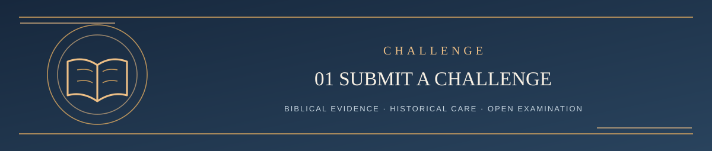

  

<h1 align="center">Step 1 — Bring a Biblical Challenge</h1>

<em>Bring your strongest scriptural argument and invite a fair examination</em>

✦ <strong>Scripture governs</strong> · Evidence matters · Every claim remains testable ✦

Disagreement with LST is welcome. You may write the argument yourself or ask your preferred AI to develop its strongest biblical case. The AI does not have to accept LST to participate.

A useful challenge identifies five things:

1. **Exact current claim** — quote the current LST wording or name its chapter.
2. **What is wrong** — identify the exact proposed defect, omission, or overstated confidence.
3. **Biblical evidence** — work the strongest relevant passages in context, not only lists of references.
4. **Proposed correction** — what should the theology say, or what uncertainty should it admit?
5. **Fair falsification test** — what evidence could lead you to retain the current interpretation?

You do not need to submit five separate essays. You may ask clarifying questions. New source discoveries, including ancient Greek and Hebrew usage, are legitimate evidence to evaluate.

**Submit your challenge** using the [GitHub Issues page](https://github.com/kenkibbey/living-systematic-theology/issues) and the **Challenge an LST Position** template. An issue may need clarification before formal examination; filing it does not start a guaranteed review deadline.

Check for a related topic first. Any contributor may add relevant evidence, arguments, corrections, sources, or questions to an existing issue; a genuinely distinct challenge may receive its own linked issue. Substantive challenge issues remain open and unlocked by default, with a maintained summary of the current position, verdict or review status, evidence, and unresolved questions. Participation has no fixed reply limit or response deadline. See the [continuing review rules](../CONTRIBUTING.md#continuing-review-and-issue-status) for review responsibilities, administrative exceptions, and moderation.

A separate non-doctrinal question or typographical report should not need a theological challenge. An additional simple reporting form is planned.

---

**[Continue → Step 2: Interpretation and Review Rules](02_METHOD_AND_CURRENT_RULES.md)**

[Return to Challenge Contents ↑](README.md) · [Main Start Here ↑](../README.md#start-here)
