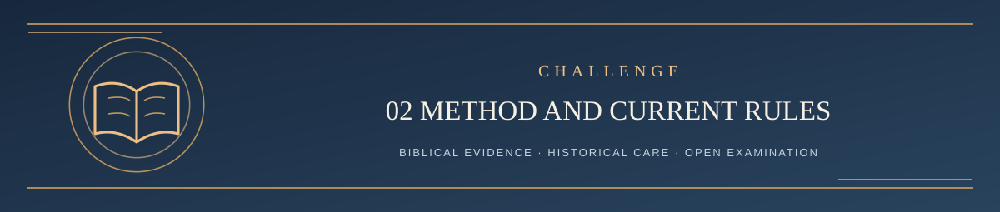

  

<h1 align="center">Step 2 — Interpretation and Current Challenge Rules</h1>

<em>The text in context comes first; both sides face the same standard</em>

✦ <strong>Scripture governs</strong> · Evidence matters · Every claim remains testable ✦

This is the public explanation of LST's **current** approach, not the independent four-AI pilot. The current Systematic governs theology, and [CONTRIBUTING](../CONTRIBUTING.md) contains the **binding public challenge deadlines and procedural rules**.

## How Scripture is interpreted

The Systematic states the broad order: **Text → Grammar → Context → Meaning → Theology**. For a more careful audit, those five movements are expanded into seven concrete checks:

1. **Establish the text:** actual passage, translation, textual witness and relevant variants.
2. **Grammar and words:** syntax, discourse and the meanings warranted by that specific context.
3. **Historical context:** language use, first audience, cultural and covenantal background. New historical evidence can correct bad interpretations.
4. **Literary context:** genre, paragraph, book-level argument and original authorial purpose.
5. **Local meaning:** what the writer says, strongly implies, may allow, and does not prove.
6. **Canonical reading:** how the whole Bible, particularly the inspired interpretations of Christ and the apostles, bears on the passage. Do not erase the earlier meaning.
7. **Theological synthesis:** distinguish direct teaching from inference, weigh all major countertexts, and speak with only the confidence Scripture warrants.

These **are the same integrated grammatical-historical-literary-canonical approach**, not conflicting systems. The five movements are a summary; the seven checks make them inspectable. The longer Revision Resistance and AI auditor checklists add decision obligations, not additional sources of biblical authority. Dependence on the Holy Spirit does not license a reviewer to claim that God endorsed the reviewer's private interpretation.

## How Revision Resistance works

Before accepting a proposed doctrinal change, test the **strongest positive biblical case for retaining** the current proposition, even if an existing proof text was poor. Then test the best biblical case against it and the proposed correction **under the same standards**. The defender's duty is to present the strongest *truthful* retention argument; a successful rebuttal of a weak challenge **does not** by itself establish the doctrine. Likewise, a real error in LST does not automatically establish the challenger's replacement.

Distinguish: proven doctrine with a weak argument; overconfident but still possible synthesis; demonstrably false doctrine; genuinely unresolved issue. Do not accumulate mutually contradictory teachings without settling their actual biblical warrant.

## The official public procedure

The maintainer handles issue intake and official publishing. Reasoned adjudications are published with sources, limitations, objections, and a verdict: **sustained, partially sustained, not sustained, or unresolved**. The current procedure allows **three substantive rebuttal rounds** and seven days to answer a published adjudication while rounds remain. Clarifications do not automatically use a round. Silence does not prove a doctrine.

The established detailed rules, optional tools, and public response structure are gathered at the end rather than interrupting the reading:

- [Complete official procedure](../CONTRIBUTING.md)
- [Revision Resistance evidence standard](../LST_REVISION_RESISTANCE_GUIDE.md)
- [Optional, complete public AI Auditor Prompt](../LST_OFFICIAL_AI_AUDITOR_PROMPT.md)
- [Public verdict template](../CHALLENGE_VERDICT_TEMPLATE.md)

A four-AI independent role-based method has been **proposed** and its four prompts published. It is not yet adopted. The governing current review and the proposed experimental review must not be confused.

---

**[Continue → Optional: Four-AI Public Pilot](../REVIEW/README.md)**

[Return to Challenge Contents ↑](README.md) · [Main Start Here ↑](../README.md#start-here)
