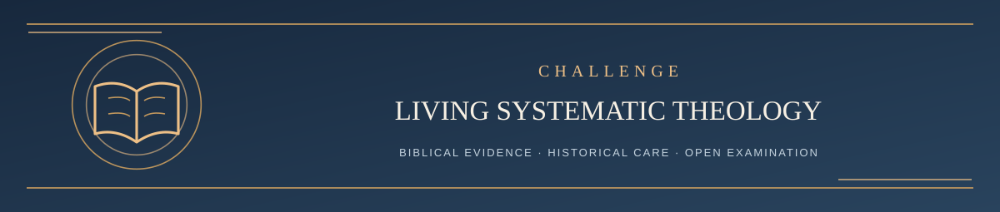

  

<h1 align="center">Challenge LST — Start Here</h1>

<em>Questions and honest biblical disagreement are welcome</em>

✦ <strong>Scripture governs</strong> · Evidence matters · Every claim remains testable ✦

Everyone may challenge LST without being a theologian or using AI. Scripture, not the number of comments or the popularity of a viewpoint, supplies the evidence.

**Not ready to file a formal challenge?** You're welcome to join the [Bible Questions & Discussion! welcome thread](https://github.com/kenkibbey/living-systematic-theology/discussions/38) or explore [all community Discussions](https://github.com/kenkibbey/living-systematic-theology/discussions). Questions, explorations, and disagreement can happen there without entering the formal adjudication queue. If discussion develops into a specific testable objection, use the challenge steps below to submit an Issue.

## Table of contents

| Step | Reading | Purpose |
| --- | --- | --- |
| 1 | [Bring a Biblical Challenge](01_SUBMIT_A_CHALLENGE.md) | What a useful challenge contains and how to submit |
| 2 | [Interpretation and Review Rules](02_METHOD_AND_CURRENT_RULES.md) | Current biblical interpretive method, Revision Resistance, responses and publication safeguards |
| Optional | [Proposed Four-AI Independent Review](../REVIEW/README.md) | The **unadopted pilot** and all four published AI prompts |

**Important:** Step 2 explains the **current official process**. The separate four-AI guide is an openly proposed design and has not yet independently adjudicated earlier GitHub issues.

---

**[Continue → Step 1: Bring a Biblical Challenge](01_SUBMIT_A_CHALLENGE.md)**

[Return to Main Start Here ↑](../README.md#start-here)
