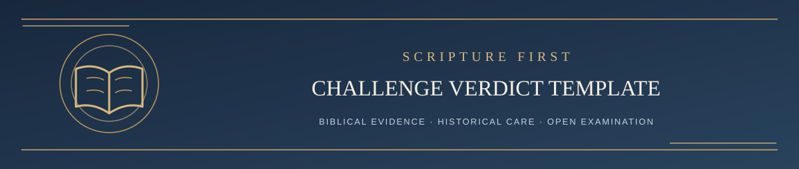

  

<h1 align="center">LST Challenge Verdict Template</h1>

<em>A public framework for reasoned, Scripture-based challenge decisions</em>

✦ <strong>Scripture governs</strong> · Evidence matters · Every claim remains testable ✦

This template governs the public disposition of challenges submitted through the Living Systematic Theology GitHub repository.

A verdict does not become authoritative merely because it is written by an AI, maintainer, contributor, or theological tradition. Scripture remains the final authority. The current governing LST documents in the private Google Drive working repository remain the project's source of truth until an approved revision is incorporated there under the normal versioning rules.

## Challenge

**Issue:**  
**Challenger (as publicly identified on this issue):**  
**Filed from account / argument source if known (do not assume these are identical):**  
**LST doctrine / wording challenged:**  
**Proposed correction:**  
**Maintainer approving public disposition:**  
**AI assistance used and its limitations (research, drafting, criticism, or none; do not guess):**  
**Independent external review, if any (not internal AI critique):**  

## Review Status

Record the review stage and current verdict separately from GitHub open/closed state. An open issue may have a completed adjudication; a verdict remains open to substantive correction.

Choose the applicable review status or verdict:

- **UNDER REVIEW** — The challenge has been accepted for examination. No conclusion has yet been reached.
- **SUSTAINED** — The biblical case requires LST to change its present doctrine, wording, confidence level, or classification.
- **PARTIALLY SUSTAINED** — The challenge exposes a real defect, but does not establish the challenger’s entire proposed conclusion.
- **NOT SUSTAINED** — The challenge does not overturn or materially weaken the current LST position after examination.
- **UNRESOLVED** — The challenge creates substantial biblical pressure, but the evidence does not presently justify either retaining the current formulation unchanged or adopting the proposed alternative as settled.

## 1. Exact Question Under Review

State the precise issue. Do not allow the dispute to expand into a general debate when one proposition can be tested.

## 2. Controlling Biblical Texts

List the passages carrying the most weight for both the challenge and the current LST position.

## 3. Strongest Case for the Challenge

Present the challenger’s argument in its strongest responsible form.

Do not answer a weaker version merely because it is easier to defeat.

## 4. Strongest Case for Retaining the Current LST Position

Apply Revision Resistance before changing LST.

Identify the strongest biblical reasons the present formulation may still be correct, including supporting passages, contextual arguments, canonical considerations, and any weaknesses in the proposed revision.

## 5. Exegetical Findings

Work the relevant passages in context.

Distinguish:

- what the text directly states;
- what it strongly implies;
- what requires systematic inference;
- what remains possible but unproved;
- and what the text does not establish.

Where lexical, grammatical, textual, historical, or background claims carry doctrinal weight, they should be verified before they are allowed to control the verdict.

### Public Evidence-Coverage Check

For each material biblical or historical point raised by the challenger, record **claim or passage → finding → remaining objection**. Identify independently consulted sources, disputed sources, and evidence that could not be checked. Do not call an argument refuted when the controlling passage or premise has not actually been examined.

**Public sources consulted and their role:**  
**Material sources not accessed or verified:**  
**Strongest challenged premises still under pressure:**  
**Specific evidence or reasoning that would change this verdict:**  

## 6. Symmetrical Test

Apply the same evidentiary standard to both sides.

Do not preserve an LST position merely because it is traditional, useful, load-bearing, or already written into the system.

Do not revise an LST position merely because a competing interpretation is possible or initially persuasive.

Ask in both directions:

> **What did the inspired author intend, and does the whole counsel of Scripture sustain the conclusion?**

### Accountability Check Before a Verdict

Confirm the outcome is supported by the cited public reasoning, not merely an AI-generated conclusion. Distinguish a source-backed finding from the language model's own assessment. Identify unresolved evidence, even when the formal finding is NOT SUSTAINED. Human approval of a public response is required but does not establish independent peer review.

## 7. Verdict

**Status:** SUSTAINED / PARTIALLY SUSTAINED / NOT SUSTAINED / UNRESOLVED

Explain the result plainly.

State whether the challenge affects:

- doctrine;
- wording;
- confidence level;
- proof texts;
- argument structure;
- counter-text treatment;
- unresolved-question status;
- or nothing material.

## 8. Required LST Action

Choose the appropriate action:

- no change;
- strengthen the existing argument;
- clarify wording without doctrinal change;
- lower or raise confidence;
- reclassify the claim;
- add an unresolved question;
- revise doctrine;
- abandon an unsupported claim.

No governing LST document is changed merely because a verdict recommends revision. Any actual governing change requires maintainer approval and the normal Google Drive versioning workflow.

## 9. Public Response to the Challenger

The public issue response must be understandable without private Facebook conversations, participant-specific Thread Ledgers, or hidden AI deliberations. No such private material may be published or quoted in order to justify a GitHub verdict. Use Scripture, the public issue's argument, and independently citable public sources instead.

Follow the complete [public Revision Resistance disclosure standard](LST_REVISION_RESISTANCE_GUIDE.md), including the strongest case for *retaining* LST, the strongest case *against* it, a source/evidence coverage record, a fair account of surviving objections, and clear authorship and review disclosures.

The public adjudication should tell participants:

1. what status the challenge received;
2. which biblical texts controlled the result;
3. whether LST changed or remained the same;
4. if it changed, what changed and where;
5. if it did not change, why the challenge did not overturn the present position;
6. whether any question remains unresolved.

A challenger should not be asked to submit a serious biblical objection into a black hole. The public issue should preserve the reasoning and outcome.

## 10. Continuing Review and Issue Status

Maintain this summary separately from the preserved history of earlier arguments and decisions. Update it when substantive review changes the record.

- **Summary updated at (UTC):**
- **Present LST position and version:**
- **Review stage:** Submitted / awaiting clarification / queued or deferred / under review / adjudication complete
- **Current verdict:** Sustained / partially sustained / not sustained / unresolved / not yet adjudicated
- **Adjudication posted at (UTC), with link:**
- **Main evidence and reasoning considered, with links:**
- **Verified changes and revision links, if any:**
- **Strongest unresolved questions and evidence or reasoning that could change the result:**
- **Related issues and review records:**
- **GitHub state:** Open by default / exceptional administrative closure with recorded reason
- **Moderation status, if applicable:** Record any locking reason separately

Substantive challenge issues remain open and unlocked by default. Any contributor may add relevant biblical arguments, objections, corrections, sources, or questions on this same issue, without a fixed rebuttal-round limit or response deadline. Apply the [continuing review procedure](CONTRIBUTING.md#continuing-review-and-issue-status): the maintainer or an authorized human reviewer assesses later contributions, and renewed review and Revision Resistance may be warranted by materially new or previously overlooked evidence, a misread passage, a material factual or source error, or a substantive defect in the reasoning. Repetition alone does not require a full adjudication, and no immediate response is guaranteed; show queued or deferred review and its reason when practicable. Acceptance or withdrawal may end the original challenger's participation while the topic record remains available to others. Silence, acceptance, participation counts, and issue state prove no doctrine.

## 11. Versioning and Public Record

If the challenge produces an approved LST revision:

1. update the current Living Systematic Theology and assign the appropriate Systematic version;
2. synchronize any affected stable supporting governing documents without giving them independent semantic version numbers;
3. preserve superseded snapshots in Old Systematics;
4. update the Revision Record when appropriate;
5. synchronize the approved current public documents to GitHub;
6. post the resulting Systematic version or revision reference on the issue;
7. update the maintained summary with the verified result and keep the substantive issue open and unlocked for continuing contributions by default.

Use a **minor increment** when the challenge materially refines LST without reversing an affirmatively held doctrine. Use the **next major .0 version** when Scripture requires an affirmatively held doctrine to be reversed or abandoned in substance.

If the challenge is **NOT SUSTAINED**, publish the reasons and invite relevant contributions on the same open issue. If it is **UNRESOLVED**, state the unresolved questions clearly in the maintained summary; elapsed time does not settle the underlying doctrine.

Administrative closure requires a documented reason under the [administrative closure rules](CONTRIBUTING.md#administrative-closure). Inspect duplicates for distinct arguments or evidence, preserve any material contribution in the continuing issue or a linked public record, and link the canonical issue with the reason for redirection before closing. Misplaced matters may be redirected with a link or explanation; an explicit request to close a resolved or withdrawn case may be honored. Acceptance alone is not a closure request. Locking is a separate moderation action requiring its own recorded reason; theological disagreement does not justify it. Previously closed cases retain their recorded history, with reopening a separate maintainer decision.
