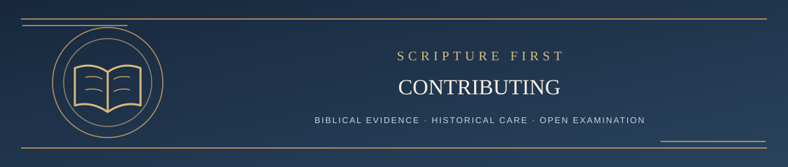

  

<h1 align="center">Contributing to Living Systematic Theology</h1>

<em>How to ask questions, challenge claims, and participate constructively</em>

✦ <strong>Scripture governs</strong> · Evidence matters · Every claim remains testable ✦

Living Systematic Theology welcomes serious biblical challenge.

**Open discussion is welcome too.** [GitHub Discussions](https://github.com/kenkibbey/living-systematic-theology/discussions) is a place for biblical questions, theological conversation and shared sources; [start with the pinned welcome thread](https://github.com/kenkibbey/living-systematic-theology/discussions/38). **Discussions are not formal LST challenges** and do not initiate formal review. For a precise doctrinal or methodological challenge requiring a documented verdict, follow the Issue process below.

The purpose of this repository is not to crowdsource doctrine, collect votes, or reward the most popular theological tradition. The purpose is to expose LST to arguments strong enough to correct it where Scripture requires correction and strong enough to strengthen it where its present formulation survives examination.

## The Authority Structure

Scripture is the final authority.

The current governing LST documents in the editable Google Drive working repository control LST's present formulation. This public repository publishes the relevant current rules and theological text so a visitor can examine them without access to the private working files.

This GitHub repository is the public publication and challenge repository. It exists so people can read the current public LST documents, inspect the revision history, and challenge the system openly.

A GitHub issue, comment, vote, pull request, AI answer, theological tradition, or opinion does not become LST doctrine merely because it appears here.

## Independent four-AI review: proposed public pilot

A [step-by-step public pilot guide](REVIEW/README.md) publishes the proposed four-role review process, public task prompts, and scriptural method. **Current owner-reported pilot setup (October 21, 2026):** future Prompt B examinations use a separate **LST Defender Revision Resistance** project with the public [Prompt B](REVIEW/PROMPT_B_LST_DEFENDER.md) as its assigned role instructions, not the private T.A.I.T./LST project instructions. Record actual prompt version, inputs, tool access, and any additional context if present; a standalone project does not guarantee perfect isolation or neutrality. **Historical exception:** the completed [Issue #33](https://github.com/kenkibbey/living-systematic-theology/issues/33) Prompt B examination did use the earlier T.A.I.T.-assisted context, and its original disclosure is preserved. The independent adjudicator and verifier remain separately instructed. **This pilot arrangement is not an amendment to current official challenge policy.** Existing submission and rebuttal rules continue unless separately approved and verified. No four-AI examination is called fully source-verified without an actual, documented verification.

## Stewardship, AI assistance, and independent review

**Ken Kibbey** (GitHub account [kenkibbey](https://github.com/kenkibbey)) maintains LST and is responsible for official doctrinal revision and publication decisions. AI tools, including **T.A.I.T. | The AI Theologian**, may assist with researching sources, reconstructing arguments, drafting assessments, and testing positions adversarially. These tools are **research assistants, not independent doctrinal authorities or autonomous publishers**. An AI role-playing a critic or reviewing its own analysis is **internal adversarial work, not independent peer review**. Claims of external, independent review must identify the actual reviewer or process and its limitations.

## Public Revision Resistance Standard

The [Revision Resistance guide](LST_REVISION_RESISTANCE_GUIDE.md) explains the biblical and evidential parameters used when a change is proposed, including the obligation to construct the strongest case for keeping the current formulation before weighing a proposed revision. Challengers can inspect those standards and hold the project to them. The guide identifies methodological questions currently under review rather than silently resolving them.

Public adjudications should be sufficiently self-contained to inspect without access to internal deliberations. **Facebook conversations and private Thread Ledgers are not copied to GitHub or disclosed to support a public ruling.** Published GitHub submissions and approved public materials remain available as the public record.

## Optional AI Pre-Submission Audit

Before opening a challenge, you may [copy the Official LST AI Auditor Prompt](LST_OFFICIAL_AI_AUDITOR_PROMPT.md) into any AI. Provide the **current** LST passage and grade, your proposed correction, and the strongest biblical evidence. The prompt reproduces the public Revision Resistance examination rules, including the strongest case for keeping LST before testing a change. You can also run it against your own theology.

**This is not required.** An AI's preliminary verdict is not an official LST decision and does not determine whether your issue can be submitted. The human-reviewed, public process below still applies.

## How to Challenge LST

Open an Issue and choose **Challenge an LST Position**.

Submit one coherent argument. You do not need to write five separate responses, but a useful challenge should include:

1. the exact LST claim being challenged;
2. what you believe is wrong, overstated, understated, misunderstood, or insufficiently demonstrated;
3. the Scripture passages that make your strongest case and your argument from them;
4. the conclusion you believe Scripture requires instead; and
5. what biblical evidence or argument would cause you to retain the present LST position.

The purpose of the fifth item is to make the challenge testable rather than merely place two opinions beside one another.

You may appeal to theologians, confessions, church traditions, historical sources, linguistic work, or other research as evidence and context. None of those authorities can replace the biblical case.

## What Happens After a Challenge Is Submitted

A challenge is treated as a claim to examine, not as a verdict.

**Initial handling.** Opening an issue puts it in the public submission queue. The maintainer reviews the issue, possibly with AI help, to identify the precise proposition, supporting passages, and whether it belongs in this challenge process. The maintainer may request clarification or sources, accept it for substantive review, queue or defer the examination because more work or available capacity is needed, or redirect a non-challenge to the appropriate discussion. If review is deferred, the issue should be marked accordingly and the reason explained when practicable. **Deferred and awaiting-clarification are administrative intake states, not rulings on biblical truth.** Neither a newly opened issue nor an automated issue alert is a completed theological review.

**Timing and responsibility.** There is no guaranteed time to initial response or to a full adjudication. The issue itself is the place to check for progress; GitHub notifications depend on the submitter's settings. Ken retains responsibility for approving official results, changes to current governing documents, and publication.

The normal process is:

1. **Define the challenge.** Identify the exact LST wording, the proposed correction, and the passages carrying the argument.
2. **Work the text.** Examine the relevant passages in their grammar, context, literary setting, historical setting, and place in the canon.
3. **Build the strongest case for retaining the current position.** LST must not revise merely because an objection initially sounds strong. Supporting texts and arguments for the present formulation must be examined seriously.
4. **Build the strongest case for revision.** The challenge receives the same standard of evidence as the existing position.
5. **Compare the cases under the same rules.** Scripture must decide the question. Tradition, usefulness, popularity, and the fact that a doctrine is already written into LST cannot preserve an unsupported claim.
6. **Reach a provisional verdict.** A challenge may be rejected, may expose a weak argument that needs strengthening, may require a confidence change or qualification, or may require doctrinal revision.
7. **Approve and version any real change.** No public challenge directly edits the governing theology. An approved change is first incorporated into the private working repository under LST's versioning rules, with superseded snapshots preserved and the Revision Record updated when appropriate.
8. **Synchronize the approved public version to GitHub.** Only after the governing documents have been updated is the corresponding public copy changed here.

The GitHub issue that prompted a change remains a continuing public record so readers can see what was challenged, how it was examined, and why LST changed or did not change. Substantive challenge issues remain open and unlocked by default.

## Versioning Policy

Only the **Living Systematic Theology** carries the project's active semantic version number. Its current public filename is stable: `LIVING_SYSTEMATIC_THEOLOGY.md`. The current Creed also uses the stable filename `LST_CREED.md`. Supporting governing documents do not receive independent semantic version numbers.

A **minor version increment** records a material refinement that does not reverse an affirmatively held doctrine. Examples include clarification, qualification, evidence reweighting, confidence adjustment, adding or removing proof texts, changing an unresolved-question status, or strengthening an argument while retaining the doctrine.

A **major version increment** is reserved for a genuine doctrinal overturn: Scripture requires LST to reverse or abandon in substance an affirmatively held doctrine. A positive doctrine held as confession or defended synthesis counts here. If such a doctrine is contradicted, abandoned, or reduced to `not demonstrated` because its positive claim cannot be sustained, the next release advances to the next major number and resets the minor number to zero. Lowering a defended synthesis to an argued possibility remains minor if the interpretation is still a genuine possibility rather than abandoned, as in Versions 2.1 and 2.2. These are the public operative versioning rules. The private working repository uses the same rule, and any change must be publicly documented and verified.

Version **2.0** is the first release produced by the major-version rule. From here, routine non-overturning refinements proceed **2.1, 2.2**, and so on. The next genuine doctrinal overturn advances the Systematic to **3.0**.

The source of the correction does not control the number. A GitHub challenge, internal audit, or other serious examination is treated the same way. The significance of the doctrinal change controls the version.

Stable current filenames do not erase history. Before a stable governing file is materially changed, the superseded snapshot is preserved in the private **Old Systematics** archive under a historical filename tied to the relevant Systematic version, revision, or date. Git history and the Revision Record preserve the public development.

## Challenge Status and Public Verdict

Every submitted challenge should have a clearly identified, maintained summary of the present LST position and version, the current challenge verdict or review status, the main evidence and reasoning, any verified changes, and the strongest unresolved questions. Update it when substantive review changes the record, with links to the relevant adjudication and revision. Distinguish that summary from the preserved history of earlier arguments and decisions.

Theological verdict, review stage, and GitHub open/closed state are separate: an open issue does not mean the doctrine is unsettled, and an adjudication marked complete does not make its conclusion immune from correction.

Review stages and verdicts include:

1. **SUBMITTED** — The issue has been opened and is awaiting review.
2. **AWAITING CLARIFICATION / DEFERRED** — An administrative pre-review state when information or review capacity is lacking; this is not a theological verdict.
3. **UNDER REVIEW** — The challenge has entered substantive examination against the current governing LST documents and Scripture. A status label or issue update should show this status.
4. **SUSTAINED** — The challenge requires a material LST change.
5. **PARTIALLY SUSTAINED** — The challenge exposes a real defect, but does not establish the challenger’s entire proposed conclusion.
6. **NOT SUSTAINED** — The present LST position survives the challenge at its current doctrinal level, though its wording or argument may still be clarified or strengthened.
7. **UNRESOLVED** — The challenge creates substantial biblical pressure that cannot yet be responsibly settled in either direction.

Post a self-contained adjudication on the same GitHub issue using the [LST Challenge Verdict Template](CHALLENGE_VERDICT_TEMPLATE.md). Invite correction and rebuttal from any contributor in that issue; run Revision Resistance again when a contribution supplies materially new or previously overlooked evidence, exposes a material error, or identifies a substantive defect in the reasoning.

The public verdict should identify the controlling passages, explain the strongest case for retaining the current formulation before weighing the strongest case for revision, address material objections, identify source limitations, state the Revision Resistance result and what evidence or reasoning could change it, explain whether LST changed, and point to any resulting revision or version number.

The person who submitted the challenge should therefore be able to see how the objection was handled. GitHub will provide issue notifications according to that user’s own notification settings.

New challenge Issues may be monitored and surfaced to the maintainer automatically, but the theological verdict itself is not automatic. A challenge must actually be examined, and no governing document changes without maintainer approval.

## Continuing Review and Issue Status

Substantive challenge issues remain open and unlocked by default. Each issue is a continuing public record for examining and refining LST. There is no fixed rebuttal-round limit or response deadline. Any contributor may add relevant biblical arguments, objections, corrections, sources, or questions on the same issue. Link related issues; a genuinely distinct challenge may receive its own linked issue.

Acceptance or withdrawal can end the original challenger's participation without closing the issue or preventing others from contributing. Human approval, historical preservation, appropriate versioning, and independent verification of governing and public changes remain required.

The maintainer or an authorized human reviewer assesses later contributions. Materially new or previously overlooked evidence, a misread passage, a material factual or source error, or a substantive defect in the reasoning can warrant renewed review and Revision Resistance. An argument need not be newly discovered to expose an error that the existing decision did not adequately address. Relevant contributions are not rejected merely because a prior decision was posted, time passed, or a reply count was reached. Repetition alone does not require another full adjudication. There is no guaranteed immediate response or obligation to prolong repetitive exchanges; a review may be queued or deferred with its status and reason made clear when practicable.

### Administrative closure

Administrative closure is exceptional and must have a recorded reason. A duplicate may be closed only after checking for distinct arguments or evidence, preserving any material contribution in the continuing issue or a linked public record, and linking the canonical issue with the reason for redirection. A misplaced issue may be redirected with a link or explanation, and an explicit request to close a resolved or withdrawn case may be honored. None of these actions establishes a theological verdict or justifies discarding substantive evidence. Do not close an issue merely because LST disagrees with the challenge, the original challenger accepts a result, or an exchange has reached diminishing returns.

### Moderation

Moderation is separate from adjudication. Spam, harassment, privacy violations, and persistent off-topic disruption may be moderated proportionately; locking requires a distinct, recorded moderation reason and is not a response to theological disagreement. Open issues do not promise unrestricted off-topic posting. Silence, acceptance, the number of comments or participants, and issue state prove no doctrine. Participation counts describe participation, not the strength or truth of a biblical case.

Previously closed cases retain their recorded history; reopening is a separate maintainer decision. Preserve archived reports, historical policy entries, and closure notices. The proposed four-AI workflow remains a separate, unadopted pilot.

## Pull Requests

For now, theological revisions should begin as Issues rather than direct Pull Requests.

A Pull Request does not establish doctrine and should not be used to bypass the challenge process. Direct proposed edits to governing theological documents may be redirected to an Issue so the biblical argument can be examined before wording is changed.

This policy may expand later as the project grows.

## What Counts as a Successful Challenge?

A challenge succeeds when the best available biblical case shows that LST's current formulation cannot responsibly be sustained at its present wording or confidence level.

Success does not always mean replacing one doctrine with another. A successful challenge may show that:

- a doctrine is false;
- a conclusion is stronger than the evidence permits;
- a conclusion is weaker than Scripture permits;
- a proof text was misused;
- an argument is incomplete even though the doctrine survives;
- a hard counter-text was not adequately handled; or
- an unresolved question was prematurely treated as settled.

Likewise, a failed challenge is still useful if it forces the present position to be stated more clearly or defended with better exegesis.

## The Governing Principle

> **Living Systematic Theology seeks to state the theology of Scripture as nearly as fallible interpreters can, speaking with the certainty Scripture gives, refusing certainty Scripture does not give, adding nothing the text cannot sustain, and surrendering nothing the text requires us to confess.**

Where Scripture speaks clearly, LST should speak clearly.

Where Scripture does not settle a question, LST should not pretend that it has.

The goal is not to protect LST.

The goal is to make LST answerable to Scripture.
