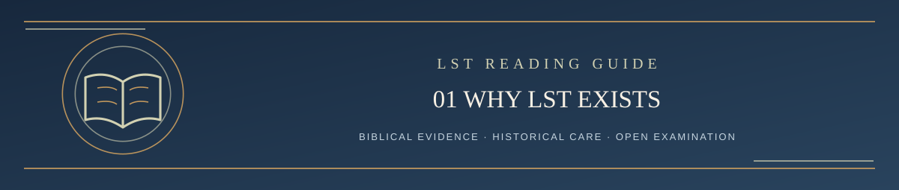

  

<h1 align="center">Step 1 — Why Living Systematic Theology Exists</h1>

<em>A Scripture-governed reading path: clear, careful, and open to examination</em>

✦ <strong>Scripture governs</strong> · Evidence matters · Every claim remains testable ✦

Living Systematic Theology (LST) is a fallible attempt to understand and express the theology of Scripture as faithfully as possible. **The Bible does not change with LST. LST must change wherever Scripture requires it.**

Christians have spent centuries studying Scripture, developing theological systems, debating difficult texts, and preserving valuable insights. LST takes that history seriously, but does not begin by declaring Calvinism, Arminianism, Covenant Theology, Dispensationalism, or another school immune from examination. Every tradition, including LST, must answer to Scripture.

Modern tools can compare passages, trace arguments, examine historical sources, and locate weaknesses at a speed earlier generations could not. Artificial intelligence makes more extensive testing possible, but **AI is not an authority on what God has revealed**. Its claims must be examined against the biblical text.

LST's aim is not novelty, popularity, or winning debates. It is to state what Scripture teaches at the confidence the evidence supports and to welcome serious correction when the evidence requires it.

That is why this repository contains a current theology, a creed, revision history, and a public challenge procedure. The current formulation is not a finished system protected from scrutiny.

The central question is:

> **What did God actually reveal, and how closely can our theology conform to it?**

---

**[Continue → Step 2: Scripture and the Governing Maxim](02_SCRIPTURE_AND_MAXIM.md)**

[Return to Start Here / Table of Contents ↑](../README.md#start-here)
