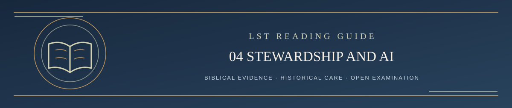

  

<h1 align="center">Step 4 — Who Runs LST and How AI Is Used</h1>

<em>A Scripture-governed reading path: clear, careful, and open to examination</em>

✦ <strong>Scripture governs</strong> · Evidence matters · Every claim remains testable ✦

Living Systematic Theology is maintained by **Ken Kibbey** (GitHub account: **kenkibbey**). He is responsible for the repository, access, privacy, historical preservation, official versions, and authorized publication.

**T.A.I.T. | The AI Theologian** is a ChatGPT-based theological research and discussion assistant informed by the current LST documents. It can study and compare biblical passages, trace arguments, and help construct the strongest legitimate case for retaining LST. It is not an independent theological referee.

The distinction matters. A defender intentionally argues for an existing position. A neutral adjudicator should not be told to favor that position. Neither the defender nor an independent judge has the authority of Scripture.

## The proposed independent arrangement

A public **four-AI review pilot** has been documented but **has not yet been adopted as the operative challenge procedure**. In the proposed workflow, a challenger may use any AI or none; an adversarial examiner strengthens the objections; ChatGPT builds the strongest biblical defense of current LST; a separately prompted AI adjudicates; and a different AI checks that judgment. The three non-defender model roles may rotate among Grok, Claude, and Gemini. No commercial AI can be proved perfectly unbiased.

**All four proposed task prompts are publicly readable** in Step 6. A fresh ChatGPT defender using the public prompt can be more readily reproduced than a private T.A.I.T. session containing additional context. If a run uses extra instructions that cannot be fully disclosed, its transparency must be described honestly.

A proposed independent AI finding is still fallible. Human responsibility for permission, archival, and publication does not disappear. The owner should not present a private preference as if it were an independent AI verdict. The Bible remains the judge of theological truth.

---

**[Continue → Step 5: How to Challenge LST](05_HOW_TO_CHALLENGE.md)**

[Return to Start Here / Table of Contents ↑](../README.md#start-here)
