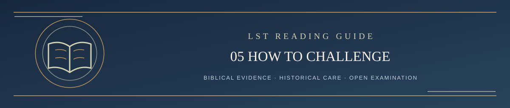

  

<h1 align="center">Step 5 — How to Challenge LST</h1>

<em>A Scripture-governed reading path: clear, careful, and open to examination</em>

✦ <strong>Scripture governs</strong> · Evidence matters · Every claim remains testable ✦

**You do not need to be a professional theologian.** Any reader may challenge a claim they believe Scripture shows to be wrong, incomplete, overstated, or understated.

You can submit one clear argument rather than five essays. The public challenge form asks for:

1. **The exact claim:** What current LST passage or doctrine are you challenging?
2. **The concern:** What is wrong, missing, or not demonstrated?
3. **The biblical evidence:** What passages and contextual arguments support your reading?
4. **The proposed correction:** What should LST say instead, if the evidence warrants it?
5. **A fair test:** What biblical evidence would persuade you to retain the current position?

You may use your preferred AI to prepare your strongest argument, or write it entirely yourself. Participation does not require AI-generated text or agreement with LST. AI cannot block submission just because it disagrees.

## What happens after submission?

A submitted GitHub Issue may need clarification or may wait for review. Submission alone does **not** start a guaranteed review clock. Under the **currently adopted** process, the reviewer examines the strongest contextual biblical evidence for both keeping and correcting the current doctrine and publishes a reasoned result. The status may be **sustained, partially sustained, not sustained, or unresolved**.

Substantive challenge issues remain **open and unlocked by default** as continuing topic records. Any contributor may add relevant biblical arguments, objections, corrections, sources, or questions on the same issue, without a fixed reply limit or response deadline. Link related issues; a genuinely distinct challenge may receive its own linked issue.

Each issue should have a maintained summary of the present LST position and version, review status or verdict, evidence considered, verified changes, and unresolved questions. An open issue can have a completed adjudication; its open state does not mean the doctrine is unsettled. The maintainer or an authorized human reviewer assesses later contributions. Previously overlooked evidence or a material error may warrant renewed review and Revision Resistance. There is no guaranteed immediate response or obligation to repeat a full adjudication for repetitive comments, and substantive revisions require owner approval.

The [continuing review rules](../CONTRIBUTING.md#continuing-review-and-issue-status) explain exceptional administrative closure and separate moderation. Duplicates are checked for distinct evidence or arguments and material contributions preserved before redirection. Acceptance alone does not close a topic; an explicit closure request may be honored with a recorded reason. Theological disagreement does not justify locking. Silence, acceptance, participation counts, and issue state prove no doctrine. Previously closed cases retain their recorded history, with reopening a separate maintainer decision.

**The four-AI independent procedure described in Step 6 is currently a pilot proposal**, not a retroactive claim about past issues and not yet a substitute for these rules.

When you finish the reading guide, **Step 7 provides direct links** to the GitHub Issues page, challenge instructions, optional public AI auditor, verdict template, and the other official documents. The public record should make it possible to understand a judgment without trusting hidden conversations. Private Facebook discussions and Thread Ledgers are not published as substitutes for independently cited biblical evidence.

---

**[Continue → Step 6: The Proposed Four-AI Review, Including All Prompts](../REVIEW/README.md)**

[Return to Start Here / Table of Contents ↑](../README.md#start-here)
