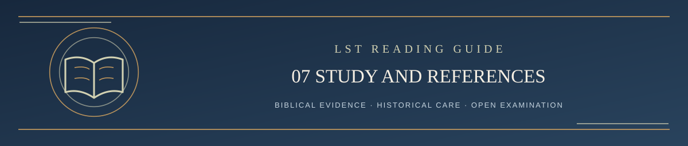

  

<h1 align="center">Step 7 — Study and Reference Library</h1>

<em>A Scripture-governed reading path: clear, careful, and open to examination</em>

✦ <strong>Scripture governs</strong> · Evidence matters · Every claim remains testable ✦

You've reached the reference shelf. The earlier chapters walked through the project without requiring detours; **the links are gathered here so you can now explore as much or as little as you wish**.

## Learn the theology

- **[LST in Five Minutes](../LST_IN_FIVE_MINUTES.md)** — A short introduction for new readers.
- **[LST Creed](../LST_CREED.md)** — A summary of present confessions, defended syntheses, and unresolved questions.
- **[Living Systematic Theology](../LIVING_SYSTEMATIC_THEOLOGY.md#contents)** — The current detailed theological formulation, Scripture arguments, and tensions. It contains its own chapter contents.
- **[Plain-language glossary](../LST_GLOSSARY.md)** — Definitions of unfamiliar terms.
- **[Theological Labels Guide](../LST_THEOLOGICAL_LABELS_GUIDE.md)** — Comparisons with familiar theological families, without turning labels into authority.

## Examine or challenge the process

- **[Open GitHub Issues](https://github.com/kenkibbey/living-systematic-theology/issues)** — Submit or read a public challenge. Choose *Challenge an LST Position* to open the available issue form.
- **[Complete current challenge rules](../CONTRIBUTING.md)** — The currently governing public procedure, deadlines, statuses, and publication responsibilities.
- **[Revision Resistance Guide](../LST_REVISION_RESISTANCE_GUIDE.md)** — Public explanation of the evidence needed to resist an unsupported revision without preserving an unsupported doctrine.
- **[Optional public AI Auditor Prompt](../LST_OFFICIAL_AI_AUDITOR_PROMPT.md)** — A prompt challengers may run themselves. It cannot reject a challenge.
- **[Public challenge verdict template](../CHALLENGE_VERDICT_TEMPLATE.md)** — The record format for an adjudication.
- **[Proposed four-AI review and its complete prompts](../REVIEW/README.md)** — The published **pilot**, separate from the currently adopted procedure.

The source of current LST doctrine is the Systematic, not this guide, the Creed, a summary, or the result of a particular AI chat. Scripture has the final word.

---

**[Continue → Step 8: Revision History and Licensing](08_HISTORY_AND_LICENSE.md)**

[Return to Start Here / Table of Contents ↑](../README.md#start-here)
