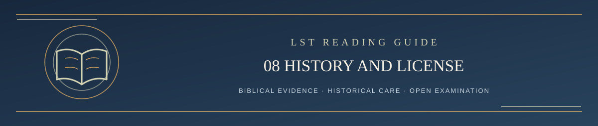

  

<h1 align="center">Step 8 — Revision History and Licensing</h1>

<em>A Scripture-governed reading path: clear, careful, and open to examination</em>

✦ <strong>Scripture governs</strong> · Evidence matters · Every claim remains testable ✦

A theology that can change should make those changes visible. LST uses a **Revision Record** to explain material doctrinal and methodological developments, including the biblical reasons, the kind of change, and unresolved evidence. Historical versions of governing Drive documents are preserved rather than silently replaced. GitHub also preserves public commit history.

The current editable working repository is in Google Drive. GitHub publishes the public formulation and hosts the challenge record. **Changing one does not automatically change the other**. An authorized update is not complete until the required changes have been independently verified.

Publication does not make the theology infallible. Nor does the silence of a challenger make a public adjudication biblically correct. The public evidence and the Scriptures remain open for examination.

## Reuse and licensing

Original LST material is shared under **Creative Commons Attribution 4.0 International (CC BY 4.0)** unless otherwise stated. Appropriate credit and notice of changes are required. Rights to third-party Bible translations, images, and other separately owned materials are **not** automatically included. Reusing a file does not make an adaptation an official LST statement.

The supporting records are here at the end rather than interrupting the reading flow:

- **[Revision Record](../LST_REVISION_RECORD.md)** — the historical reasons for significant corrections.
- **[License](../LICENSE)** — the full license terms.
- **[Public GitHub repository](../README.md)** — the current starting point and master table of contents.

You've reached the end of the guided introduction. You can return to Start Here and choose any section, or follow the references above to examine a specific doctrine or public challenge.

---

**[Reading complete → Return to Start Here / Table of Contents ↑](../README.md#start-here)**
