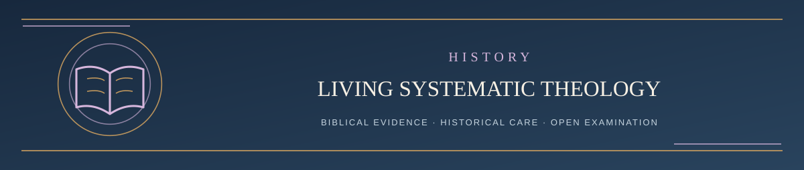

  

<h1 align="center">See What Changed — Start Here</h1>

<em>Explore where LST has changed and the reasons behind each correction</em>

✦ <strong>Scripture governs</strong> · Evidence matters · Every claim remains testable ✦

LST is a living theology because **its formulations may be corrected by Scripture**, not because Scripture changes. This reading path distinguishes theological releases, their reasons, and ordinary repository maintenance.

## Table of contents

| Step | Reading | What you'll find |
| --- | --- | --- |
| 1 | [Doctrinal Change Overview](CHANGELOG.md) | An understandable summary of important versions |
| 2 | [Complete Revision Record](../LST_REVISION_RECORD.md) | The full dated history and detailed biblical reasons |
| 3 | [Operational Changes](OPERATIONS_LOG.md) | Public information about navigation and process administration |

The **current theological version** is stated inside the [Systematic](../LIVING_SYSTEMATIC_THEOLOGY.md); this index reflects Version **2.7** as checked on October 21, 2026. The revision and operations records are historical, not separate doctrinal authorities. Superseded editable Drive governing states remain archived rather than overwritten.

---

**[Continue → Step 1: Doctrinal Change Overview](CHANGELOG.md)**

[Return to Main Start Here ↑](../README.md#start-here)
