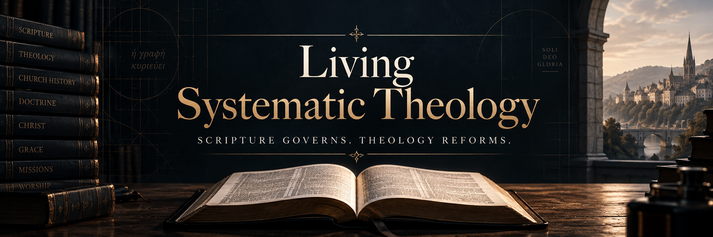

<h1 align="center">Living Systematic Theology</h1>

  

<em>A Christ-centered, Scripture-governed, continuously reforming systematic theology</em>

Living Systematic Theology (**LST**) is a fallible attempt to state the theology of Scripture as faithfully as possible. **Scripture has the final word.** This repository records what LST currently holds, how it is tested, and why it changes when the biblical evidence requires correction.

## Start Here

### Your table of contents

**Read straight through, one page at a time.** Start with Step 1. At the bottom of each page choose **Continue** for the next step, or **Return to Start Here** for this table of contents. Links to optional reference documents are gathered near the end of the journey, so you do not need to jump between documents just to understand the project.

| Step | Read | What you'll learn |
| --- | --- | --- |
| **1** | **[Why LST Exists](GUIDE/01_WHY_LST_EXISTS.md)** | Purpose, history, and why Scripture governs the project |
| **2** | **[Scripture and the Governing Maxim](GUIDE/02_SCRIPTURE_AND_MAXIM.md)** | What the project must say—and must not claim |
| **3** | **[What LST Believes](GUIDE/03_BELIEFS_AND_CONFIDENCE.md)** | Beliefs, careful confidence levels, and unsettled questions |
| **4** | **[Who Runs LST and How AI Is Used](GUIDE/04_STEWARDSHIP_AND_AI.md)** | Human stewardship, T.A.I.T., and honest limits on AI independence |
| **5** | **[How to Challenge LST](GUIDE/05_HOW_TO_CHALLENGE.md)** | How to submit a biblical objection and how review currently works |
| **6** | **[The Proposed Four-AI Review](REVIEW/README.md)** | The full step-by-step pilot, interpretive method, and **all four public prompts** |
| **7** | **[Study and Reference Library](GUIDE/07_STUDY_AND_REFERENCES.md)** | Where to read the Creed, full Systematic, explanatory guides, and official rules |
| **8** | **[Revision History and Licensing](GUIDE/08_HISTORY_AND_LICENSE.md)** | How changes are documented, historical states preserved, and material reused |

**[Begin reading → Step 1: Why LST Exists](GUIDE/01_WHY_LST_EXISTS.md)**

---

**Reading guide status:** The four-AI independent-review method in Step 6 is a **published pilot design, not the currently adopted challenge policy**. Its prompts are openly available for inspection; previous reviews must not be described as four-AI adjudications unless they really were. The current rules remain in force until formally changed and verified.

**[Return to Start Here ↑](#start-here)**
