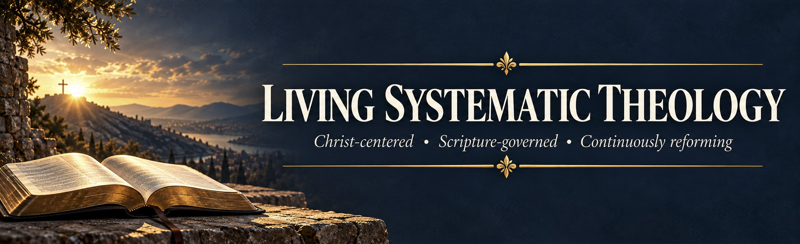

  

<h1 align="center">Living Systematic Theology</h1>

<em>A Christ-centered, Scripture-governed, continuously reforming systematic theology</em>

✦ <strong>Scripture governs</strong> · Evidence matters · Every claim remains testable ✦

**Current theological version: 2.9 · October 21, 2026**

Living Systematic Theology (**LST**) is a fallible attempt to state what the Bible teaches as faithfully as possible. **Scripture is final authority; LST can and must be corrected.** The project is maintained by **Ken Kibbey** with AI-assisted research and openly documented challenges.

### LST at a glance

> We confess the Triune God, the written Word, the eternal Son incarnate, the finished work of Christ, salvation by sovereign grace, Christ's present reign and return, the resurrection of the dead, final judgment, and the new creation. We distinguish what Scripture establishes from what requires inference and from questions Scripture has not yet settled for us.

*This is a brief orientation derived from the Creed's Short Rule, not a substitute for the current Creed or Systematic.*

## Start Here

Choose **one of four paths**. Each has its own table of contents and moves forward with **Continue → Next** and **Return to Contents ↑** at the end of each chapter.

| Your goal | Start here | What you'll find |
| --- | --- | --- |
| **📖 Read the theology** | **[Read LST →](THEOLOGY/README.md)** | Five-minute introduction, a confidence map, the Creed, and the complete Systematic |
| **⚖️ Challenge a claim** | **[Challenge LST →](CHALLENGE/README.md)** | How to submit a challenge, the governing biblical method, actual rules, and the separate four-AI **pilot** |
| **🕮 See what changed** | **[Explore the history →](HISTORY/README.md)** | Doctrinal changes, the full Revision Record, and release/version information |
| **💬 Join the conversation** | **[Discuss Scripture →](https://github.com/kenkibbey/living-systematic-theology/discussions)** | Ask Bible questions, explore interpretations, and share ideas without filing a formal challenge |

**New to the community?** [Begin with our pinned welcome discussion](https://github.com/kenkibbey/living-systematic-theology/discussions/38). Discussions are for open conversation; formal challenges are handled through the separate **Challenge a claim** path.

**Challenge issues are continuing topic records.** Substantive issues remain open and unlocked by default. Any contributor may add relevant evidence, arguments, questions, or corrections without a fixed reply limit or response deadline. A maintained summary records the present position, review status or verdict, evidence, and unresolved questions separately from the issue's open state. See the [continuing review rules](CONTRIBUTING.md#continuing-review-and-issue-status) for human review, administrative exceptions, and moderation.

The published four-AI guide is **an unadopted pilot**, not the official review procedure. Its four complete proposed AI task prompts are public. A judge's AI output is never divine authority or independent human peer review.

## What makes LST different?

Other Christian projects have pursued open-source theological discussion, revisable confessions, collaborative scriptural research, and publicly accountable revisions. LST does not claim to have invented those ideas.

What distinguishes its **documented working approach** is the **combination** of a continuously maintained systematic theology, explicit distinctions in doctrinal confidence, a strongest-case-for-retention test before revision, preserved superseded versions, public biblical challenges, and a traceable Revision Record. The four-AI judicial-style review remains a **pilot**, not the adopted challenge policy.

**[Read the source-checked comparison: How Distinctive Is Living Systematic Theology? →](RESEARCH/COMPARATIVE_STUDY_OF_REVISABLE_THEOLOGY_2026-10-21.md)**

The study compares **eight** historical, denominational and digital projects and clearly distinguishes established precedents from features for which no exact analogue was verified. It is an AI-assisted **research note, not independent theological peer review or proof of worldwide uniqueness**. [Research index →](RESEARCH/README.md)

**Project principle:** Say what Scripture establishes, at the confidence it gives; do not claim more, and do not surrender what the text actually requires.

**License:** [CC BY 4.0](LICENSE) for original LST materials, with third-party rights excluded. **Questions and conversation:** join [GitHub Discussions](https://github.com/kenkibbey/living-systematic-theology/discussions). **Formal biblical challenges:** follow the [Challenge LST path](CHALLENGE/README.md) and submit through GitHub Issues.

---

[Return to Start Here ↑](#start-here)
