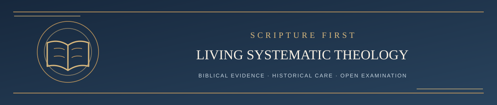

  

<h1 align="center">Living Systematic Theology</h1>

<em>A Christ-centered, Scripture-governed, continuously reforming systematic theology</em>

✦ <strong>Scripture governs</strong> · Evidence matters · Every claim remains testable ✦

**Current theological version: 2.7 · October 21, 2026**

Living Systematic Theology (**LST**) is a fallible attempt to state what the Bible teaches as faithfully as possible. **Scripture is final authority; LST can and must be corrected.** The project is maintained by **Ken Kibbey** with AI-assisted research and openly documented challenges.

### LST at a glance

> We confess the Triune God, the written Word, the eternal Son incarnate, the finished work of Christ, salvation by sovereign grace, Christ's present reign and return, the resurrection of the dead, final judgment, and the new creation. We distinguish what Scripture establishes from what requires inference and from questions Scripture has not yet settled for us.

*This is a brief orientation derived from the Creed's Short Rule, not a substitute for the current Creed or Systematic.*

## Start Here

Choose **one of three paths**. Each has its own table of contents and moves forward with **Continue → Next** and **Return to Contents ↑** at the end of each chapter.

| Your goal | Start here | What you'll find |
| --- | --- | --- |
| **📖 Read the theology** | **[Read LST →](THEOLOGY/README.md)** | Five-minute introduction, a confidence map, the Creed, and the complete Systematic |
| **⚖️ Challenge a claim** | **[Challenge LST →](CHALLENGE/README.md)** | How to submit a challenge, the governing biblical method, actual rules, and the separate four-AI **pilot** |
| **🕮 See what changed** | **[Explore the history →](HISTORY/README.md)** | Doctrinal changes, the full Revision Record, and release/version information |

The published four-AI guide is **an unadopted pilot**, not the official review procedure. Its four complete proposed AI task prompts are public. A judge's AI output is never divine authority or independent human peer review.

**Project principle:** Say what Scripture establishes, at the confidence it gives; do not claim more, and do not surrender what the text actually requires.

**License:** [CC BY 4.0](LICENSE) for original LST materials, with third-party rights excluded. **Contact or questions:** use [GitHub Issues](https://github.com/kenkibbey/living-systematic-theology/issues) and the challenge/question options explained in the second reading path.

---

[Return to Start Here ↑](#start-here)
