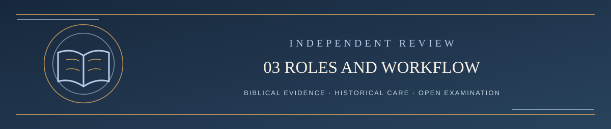

  

<h1 align="center">3. Four AI Roles and the Review Workflow</h1>

<em>The challenger’s advocate, LST’s defender, an independent adjudicator, and a verifier</em>

✦ <strong>Scripture governs</strong> · Evidence matters · Every claim remains testable ✦

**This is a proposed pilot. The published prompts at the end of this reading sequence are the reproducible task instructions.**

## What each role actually does

| Role | AI assignment | Assignment | May it decide the final verdict? |
| --- | --- | --- | --- |
| A: **Challenger's advocate** | User's choice | Present the submitter's original argument in its **strongest fair biblical form against LST**; clearly distinguish the person's claims from additional AI-developed support; acknowledge irreparable weaknesses | No |
| B: LST defender | User's choice | Defend the current wording with the strongest *positive* biblical case; answer every material objection; acknowledge whatever fails | No |
| C: Independent adjudicator | User's choice | Compare the strongest cases under the same interpretive standards, including direct biblical evidence, unresolved problems, and actual doctrinal confidence | Makes a **reasoned proposed finding**, subject to verification |
| D: Independent verifier | User's choice | Independently recheck controlling texts, sources, both sides' omissions, bias, and whether C's finding follows; flag reasons for reconsideration | No automatic rubber stamp or invisible veto |

**The challenger remains a person with a voice.** They may use any AI, or none. **Prompt A is assigned to advocate for the *challenge*, not argue against the challenger.** The assigned AI must preserve the submitter's own claims and make any AI-added biblical arguments clearly attributable to Grok. Its role does not make it the submitter's authorized personal representative and is not a substitute for the challenger's own words. The original challenge and subsequent rebuttals are included in the judge's case packet, not rewritten by the defender as the only record.

**Courtroom analogy and reusable prompts:** A is counsel for the challenger, B is counsel for LST, C is the independent judge, and D checks the judge's evidence. The public A/B/C/D prompts specify **roles only**. Each can be pasted into a separate chat and paired with its [required case packet](README.md#start-here--copy-and-paste-courtroom-workflow-role-only-prompts). GitHub publication is handled separately under the pilot runbook. **Any AI may be assigned to any role**; the roles, required evidence, and source disclosures stay the same. Fresh chats do not guarantee the absence of private account-level context; each examiner must disregard unrelated personal history where possible and disclose material context that cannot be excluded.

## Rotation and isolation

**Role B remains the disclosed advocate for retaining the existing LST position, regardless of provider.** **Current owner-reported arrangement (October 21, 2026):** a separate **LST Defender Revision Resistance** project now performs future Prompt B examinations using the published [Prompt B](PROMPT_B_LST_DEFENDER.md), without T.A.I.T.'s private LST-project instructions. Each examination must still document its actual prompt version, case packet, date/model when known, source access, and any additional effective context. Separation does not by itself prove total neutrality or absence of platform-level instructions. **Historical exception:** [Issue #33](https://github.com/kenkibbey/living-systematic-theology/issues/33) was defended in the earlier T.A.I.T.-assisted LST project; its original project-assisted attribution and limitations are preserved and not retroactively described as prompt-only. Official GitHub challenge rules remain unchanged.

**Any user-selected AI may serve A, C, or D** with appropriate case and source access in separate sessions. **Adjudicator C and verifier D must be separate examinations** from the Prompt B defender and from each other. Give C and D the unchanged original challenge and complete preceding reports, with each report's true historical/current provenance. Do not assume B used private T.A.I.T. context in a new standalone run, or erase that context from a historical case. No judge may be instructed to favor either side. Record provider/model (if known), date, actual inputs and source-access limitations; disclose substitutions and missing runs rather than implying a completed review.

No named model is intrinsically neutral. No rotation algorithm guarantees unbiased results.

## What goes to all review roles

Each role needs an explicit, source-backed case packet:

1. The **precise current LST wording**, chapter, active version, and confidence classification.
2. The challenger's **unaltered submission**, subsequent relevant rebuttals, supporting passages, and proposed correction.
3. The entire public LST defender response, plus any supplemental adversarial findings and supporting research, with clear origin labels.
4. Actual controlling Scripture passages, context, disputed readings, and verifiable source details.
5. **Same interpretive criteria** (the seven stages from chapter 2), disclosed scope, and questions still undecided.
6. A timestamped record of what each AI actually received; no secret summaries substituted for adverse evidence.

The **first-stage judge comparison** may label the competing propositions A/B rather than LST/challenger *when doing so is practicable and does not hide critical context*. The second stage reveals current LST text and confidence so that the judge can assess whether it deserves retaining, strengthening, qualifying, or overturning. Position-order reversal is a useful additional check when feasible.

## A full challenge, in sequence

1. The issue is filed publicly; the challenger may use an AI to argue as strongly as desired.
2. Confirm exact challenged wording, its confidence, decisive passages, and whether a clarification is needed; do not call intake a doctrinal verdict.
3. **The challenger's advocate** develops the best defensible form of the submitter's actual case **against LST**, with contextual biblical evidence and transparent attribution, **not** a volume-based quota. The complete public report goes into a **version-controlled Markdown file** under `REVIEW/CASES/ISSUE-XXXX/`; a short **first substantive AI review comment** with the verified full-report link goes on the original issue when feasible. **No companion GitHub issue is created.**
4. The assigned defender receives the whole case and builds **Revision Resistance**: the strongest honest case for keeping the existing claim and the exact reasons that would require conceding it.
5. The independent adjudicator reads both cases and the decisive texts, weighs positive biblical support for **both** propositions, documents misreadings and open questions, and recommends the smallest faithful correction.
6. The independent verifier independently checks the judge's evidence, including omissions and source access. A material discrepancy goes back for another visible adjudication; **do not average contradictory verdicts into a compromise**.
7. Publish the exact role record, case map, finding, verification, limitations, and any unresolved dissent. Apply the adopted rebuttal/closure procedures; do not confuse an AI reply with administrative approval.
8. Only an authorized, verified change to the **current Drive governing files**, with historical preservation and revision record, may become a new official LST version; then independently publish and verify the GitHub counterpart. A written recommendation is not an edit.

### Two decisions, not one

For each disputed proposition the adjudicator must decide **(a) what the challenge established** and **(b) what positive biblical warrant the existing claim actually retains**. It must separately evaluate the proposed replacement. “The challenger failed to prove X” is *not* “LST proved Y.” “Both readings are possible” is *not* permission to append two contradictory doctrinal statements.

### Existing challenge policy during pilot

The official GitHub process currently provides up to **three substantive rebuttal rounds** and a seven-day window after published adjudications where rounds remain. These rules are not rewritten merely by publishing this pilot. Changes to intake, deadlines, procedural disputes, and who manages the queue require a separate proposed governance revision and official verification.

---

**[Continue → 4. Verdicts, corrections, and public accountability](04_VERDICTS_AND_ACCOUNTABILITY.md)**

[Return to table of contents ↑](README.md)
