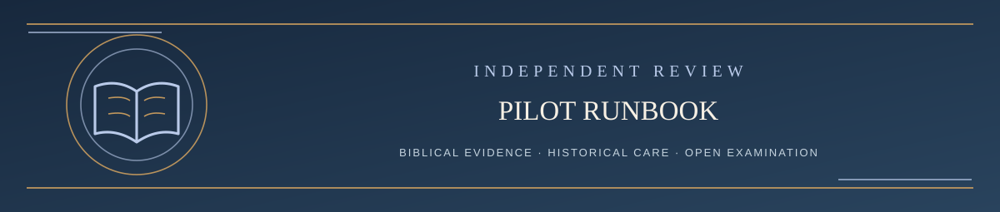

  

<h1 align="center">Four-AI Independent Review — Pilot Test Register and Runbook</h1>

<em>A reproducible plan for testing the proposed independent-review process</em>

✦ <strong>Scripture governs</strong> · Evidence matters · Every claim remains testable ✦

**Status: NOT YET VALIDATED OR ADOPTED.** This pilot permits **project-assisted ChatGPT / T.A.I.T. as Role B**, as long as its private project context and limitations are disclosed. The public defender prompt remains published, but private additional instructions mean the actual run is not fully reproducible from public prompts alone. The existing GitHub challenge rules remain official until separately revised.

## Purpose

Test whether a structured four-role review improves the quality and independence of biblical adjudication without making LST's current wording automatically favored or new theories automatically accepted.

The defender is intentionally an *advocate*. The adversarial examiner is intentionally an *opponent*. The independent adjudicator must not favor either, and the verifier must test whether the decision follows from the passages. All share the same grammatical, historical, literary and canonical controls.

## Required tasks for each trial

1. **Freeze the case.** Identify exact LST version and disputed words, original public challenge (including rebuttals), complete defender response, proposed correction, source-access limitations, and a citation to the issue's exact GitHub state. Do not rely on a single partisan summary.
2. **Record assignments.** Example: Grok = examiner; project-assisted ChatGPT / T.A.I.T. = disclosed LST defender (Prompt B); Claude = separate adjudicator; Gemini = separate verifier. A, C and D roles may rotate, but neither adjudicator nor verifier may inherit Role B's private LST project context; never reuse the same session as both judge and verifier.
3. **Use public role prompts unchanged.** Full prompts: [A](PROMPT_A_ADVERSARIAL_EXAMINER.md), [B](PROMPT_B_LST_DEFENDER.md), [C](PROMPT_C_INDEPENDENT_ADJUDICATOR.md), [D](PROMPT_D_INDEPENDENT_VERIFIER.md). Record provider/model, date, customization/memory status, and any additional constraints. If extra private instructions materially affected a run, disclosure must state that.
4. **Do not decide from prose alone.** Each reviewer must access the passages used as actual evidence, disclose source limitations, and distinguish the challenge's merit from the current doctrine's affirmative biblical warrant.
5. **Test position-order effects.** When practical, blind A/B party labels for the initial adjudication and perform a fresh swapped-order rerun. Record any changed conclusions.
6. **Publish the disagreement.** The verifier must identify material problems, not invent agreement. A major discrepancy means adjudication is not verified; a second visible examination may be necessary.
7. **Evaluate the method itself.** Look for failure to concede a genuine LST error, failure to reject a poorly supported replacement, poor source work, unsupported lexical claims, excessive hedging, and inflation of doctrinal confidence.

## Proposed initial cases

| Case | Why selected | Source |
| --- | --- | --- |
| #24: saving faith, allegiance, Greek charis and method | Competing lexical, contextual and methodological claims; prior maintainer-owned adjudication is **not** independent four-AI evidence | [Issue #24](https://github.com/kenkibbey/living-systematic-theology/issues/24) |
| #23: Father–Son relations, order and equal deity | Previously sustained *partial wording correction*, useful for testing whether the board can recognize legitimate limited change | [Issue #23](https://github.com/kenkibbey/living-systematic-theology/issues/23) |
| A submitted weak or speculative criticism of a well-established direct claim | Checks whether the board can refuse change **for the right contextual reasons**, not by inertia | To be selected and disclosed before test |

## What a report must contain

- Exact public prompt version or commit SHA, full input list, actual model assignments, and what each model truly had available.
- Original challenger material and LST defender's independent strongest scriptural case.
- Adjudicator's position-by-position, passage-by-passage analysis and distinct ratings for **challenge outcome** and **positive doctrinal warrant**.
- Verifier's truly independent critique, supporting and opposing passages checked, omissions, bias checks, and disagreement.
- Whether a proposal to change LST was made, and the difference between a *recommendation*, *approved change*, *verified Drive edit*, and *verified GitHub public release*.

**Not a completed run:** This repository presently publishes only the workflow and exact prompts. No completed Grok/Claude/Gemini independent review should be claimed until those actual outputs and provenance have been obtained and checked.

---

**[Return to the Four-AI Reading Guide ↑](README.md)** · [Challenge Contents ↑](../CHALLENGE/README.md) · [Main Start Here ↑](../README.md#start-here)
