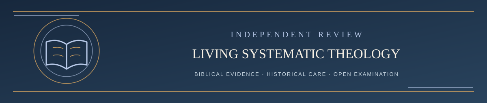

  

<h1 align="center">LST Independent Four-AI Review — Public Reading Guide</h1>

<em>A public, inspectable proposal for an independent four-AI review process</em>

✦ <strong>Scripture governs</strong> · Evidence matters · Every claim remains testable ✦

**PUBLIC DESIGN DRAFT · October 21, 2026 · Not yet the operative challenge policy**

This is the proposed next generation of Living Systematic Theology (LST) challenge review. It is published **before adoption**, so anyone can inspect the complete reasoning rules and the **full task prompts for all four AI roles**. The independent board has not yet been demonstrated in live, reproducible trials. Existing GitHub challenge rules remain effective until LST formally changes them and verifies the resulting publication.

**The goal:** Scripture corrects the theology; the theology must not control Scripture. We want rigorous resistance to *unsupported change*, not resistance to *biblically warranted correction*. No AI or human is promised to be completely unbiased.

## Start here — copy-and-paste courtroom workflow (role-only prompts)

The four public prompts below are **job descriptions**, not commands to create an issue, access an account, edit LST, or publish a verdict. You may use your **own AI providers**. The example assignments for the next trial are **Claude = A (challenger's advocate), ChatGPT / T.A.I.T. = B (LST defender), Grok = C (independent judge), Gemini = D (independent verifier)**. Provider choice does not change the biblical evidence standard.

Think of the process as a courtroom: **A is counsel for the challenger** (strongest defensible case against LST); **B is counsel for LST** (Revision Resistance and strongest defensible case for retaining its current formulation); **C is the judge** (independent, provisional assessment of both); **D is the judicial reviewer** (independent checks of the judge's reasoning and sources). The owner decides whether to adopt any recommendation, subject to Scripture and the public challenge procedure.

**Use four separate chat threads:**

1. **Thread A:** Paste [Prompt A](PROMPT_A_CHALLENGE_ADVOCATE.md), then supply **your own original issue/draft, the exact challenged current LST text and version, Scripture, and source materials**. Ask for the strongest fair formulation of your case; inspect the result before submitting any issue. Your own words and AI additions must be distinguishable.
2. **Thread B:** Paste [Prompt B](PROMPT_B_LST_DEFENDER.md), then supply **your original unedited challenge, current LST source and grades, and A's complete report**, plus relevant sources and prior public rebuttals. This thread builds the strongest honest retention case; it does not decide the verdict.
3. **Thread C:** Paste [Prompt C](PROMPT_C_INDEPENDENT_ADJUDICATOR.md), then supply **the original challenge, the current LST version, the full A and B reports, and the decisive source documents**. It independently checks the evidence and produces a provisional J1–J9 adjudication.
4. **Thread D:** Paste [Prompt D](PROMPT_D_INDEPENDENT_VERIFIER.md), then supply **the original challenge, the current LST source, complete A, B and C reports, the relevant biblical/source texts and public prompt versions**. It independently checks the proposed judgment. Without access to decisive sources, it must label its result *incomplete*, not verified.

**Bias control:** Ask each AI to ignore unrelated user history, memories, personal theology, preferences, and prior conversations, and use only the case evidence. A separate chat helps separate roles but **cannot override hidden system instructions, saved personalization or account-level context**. If your AI permits it, use temporary/fresh chats with memory and customization disabled. Disclose material additional context; do not claim guaranteed neutrality. The project-assisted official ChatGPT/T.A.I.T. defender has extra private governing context and is **openly disclosed as such**, not misrepresented as a prompt-only run.

**No special connector is necessary to reason about a complete packet**, but a model must have actual source access to claim it independently checked documents. If it cannot fetch a link, provide the relevant complete text or file; do not accept invented source checks. You may run this private four-thread test without publishing anything. Public submission, GitHub archive publication, rebuttal rights, and final owner approval are separately governed by [the current contribution rules](../CONTRIBUTING.md) and the [pilot publication runbook](PILOT_RUNBOOK.md).

## Table of contents — read in order

Read each chapter through, then use its **Continue** link at the *end*. To go elsewhere, use its **Return to contents** link. Important navigation links are kept out of the middle of the explanations.

| Step | Reading | Purpose |
| --- | --- | --- |
| 1 | [Purpose and safeguards](01_PURPOSE_AND_SAFEGUARDS.md) | What is independent, what is not, and what humans still do |
| 2 | [How Scripture is interpreted](02_SCRIPTURE_INTERPRETATION.md) | Exact seven-stage grammatical, historical, literary, and canonical method |
| 3 | [Four AI roles and the workflow](03_ROLES_AND_WORKFLOW.md) | Challenger's advocate, LST defender, independent adjudicator, separate verifier |
| 4 | [Verdicts, corrections, and the public record](04_VERDICTS_AND_ACCOUNTABILITY.md) | How evidence is weighed, contradictory claims handled, and findings published |
| 5 | [Prompt A: challenger's advocate](PROMPT_A_CHALLENGE_ADVOCATE.md) | Reusable role-only prompt; suggested Claude |
| 6 | [Prompt B: LST defender](PROMPT_B_LST_DEFENDER.md) | Full reusable task prompt for ChatGPT |
| 7 | [Prompt C: independent judge](PROMPT_C_INDEPENDENT_ADJUDICATOR.md) | Reusable role-only prompt; suggested Grok |
| 8 | [Prompt D: independent verifier](PROMPT_D_INDEPENDENT_VERIFIER.md) | Full reusable task prompt for Gemini or another independent model |

### A two-minute overview

1. A person challenges the **exact current LST claim** and may use an AI of their choice to improve the case. **Role A — Challenger's Advocate** treats the person as the source of the challenge, reconstructs the **strongest fair biblical case for their issue against LST**, and distinguishes its own added research from the submitter's actual claims.
2. **ChatGPT** is expressly assigned to defend current LST as strongly as Scripture honestly permits. It must concede a real defeat.
3. A **fresh, separately prompted AI** weighs the strongest arguments of both sides, **without being told to preserve LST**.
4. A **different model in a fresh session** checks the adjudicator's source work, hidden assumptions, fairness, and conclusions.
5. The recommendation, verification, disagreements, and remaining uncertainties are publicly recorded. The repository owner carries out administration and verified publication; a private personal preference cannot be relabeled an independent finding.

**Role rotation:** In the example deployment **Grok advocates for the submitted challenge against LST**, ChatGPT defends the current LST position, Claude adjudicates, and Gemini verifies. For subsequent issues, Grok, Claude, and Gemini may exchange examiner, adjudicator, and verifier roles; they must be **different independent sessions** and disclose assignments in each issue. **ChatGPT stays the designated LST advocate** in this proposal. Nobody's brand or model output is a theological authority.

**Role B execution and transparency — owner-authorized pilot variant (October 21, 2026):** The public [Prompt B](PROMPT_B_LST_DEFENDER.md) remains the disclosed defender role specification. **Project-assisted Revision Resistance in the LST ChatGPT project is permitted for this pilot and for subsequent pilot cases**, provided the GitHub case record expressly identifies it as **“ChatGPT / T.A.I.T. project-assisted Prompt B”**, not a fresh public-prompt-only session. The existing project has additional private governing instructions and potentially project context; their text is not published, so **exact full-prompt reproducibility and strict defender isolation cannot be claimed**. Disclose the existence and purpose of that private context, any material effects on the run, model/date where known, actual source and challenge materials, tools and access limits, and the full public B-series argument. A clean-session Prompt B-only replay is an optional independent sensitivity check, not a prerequisite for using project-assisted Role B. **A and C/D are not supplied with the private T.A.I.T. instructions; adjudication and verification remain in separate, fresh sessions with their own disclosed inputs.** This pilot disclosure change does **not** enact the four-AI process as official challenge policy.

**Complete public case reports:** [Browse the per-issue Markdown examination archive](CASES/README.md). Each original GitHub challenge stays **one issue**. A/B/C/D full reports live as separately attributed files in `REVIEW/CASES/ISSUE-XXXX/`, while short status comments and the official decision stay on the original issue. Role A is now called **Challenger's Advocate** because its assignment is to represent the submitter's strongest fair case *against LST*, not argue against the submitter. Historical Prompt A runs retain their actual original role labels and prompt versions.

No technical design eliminates all model bias. Inspectable scriptural reasoning and truthful source coverage matter more than agreement among models.

---

**[Continue → 1. Purpose and safeguards](01_PURPOSE_AND_SAFEGUARDS.md)**

[Return to AI review contents ↑](README.md) · [Return to Challenge Contents ↑](../CHALLENGE/README.md) · [Main Start Here ↑](../README.md#start-here)
