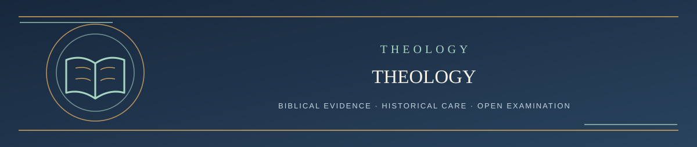

  

<h1 align="center">Read the Theology — Start Here</h1>

<em>Discover what LST teaches, how firmly it holds each claim, and why</em>

✦ <strong>Scripture governs</strong> · Evidence matters · Every claim remains testable ✦

This path starts with what LST actually teaches, **before** its process for handling objections. The official Systematic is the authoritative current LST formulation; this reading path is only an introduction. Scripture remains final.

## Table of contents

| Step | Reading | Purpose |
| --- | --- | --- |
| 1 | [LST in Five Minutes](../LST_IN_FIVE_MINUTES.md) | The basic theology without technical detail |
| 2 | [Confidence Map](CONFIDENCE_MAP.md) | Which important claims are confessed, inferred, possible, or unsettled |
| 3 | [The LST Creed](../LST_CREED.md) | Full confessional summary with qualifications |
| 4 | [Read the Systematic chapter by chapter](CHAPTERS/README.md) | Generated mobile-friendly pages for all 23 chapters and the conclusion; [complete governing source](../LIVING_SYSTEMATIC_THEOLOGY.md#contents) |

Read each page all the way through. At the end, use **Continue** or **Return to this contents page**.

If you want to challenge something you find, the final page will guide you to the separate public challenge path.

---

**[Continue → Step 1: LST in Five Minutes](../LST_IN_FIVE_MINUTES.md)**

[Return to the main Start Here ↑](../README.md#start-here)
