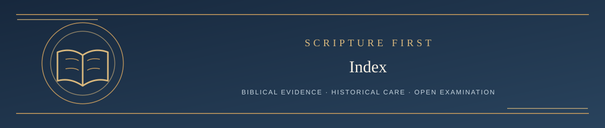

  

<h1 align="center">Living Systematic Theology</h1>

<em>A Christ-centered, Scripture-governed, continuously reforming systematic theology</em>

✦ <strong>Scripture governs</strong> · Evidence matters · Every claim remains testable ✦

**Current version: 2.9 — October 21, 2026**

LST is a fallible attempt to state Scripture's theology faithfully. The Bible is final authority; LST can be corrected. The project is maintained by Ken Kibbey with AI-assisted research and public biblical challenges.

> We confess the Triune God, Jesus Christ the eternal Son, His finished saving work, salvation by sovereign grace, resurrection, judgment and the new creation. What Scripture does not establish with certainty must not be presented as though it does.

## Choose a path

| Your goal | Start here |
| --- | --- |
| 📖 Read the Theology | [Read LST](THEOLOGY/README.md) |
| ⚖️ Challenge a Claim | [Formal biblical challenge process](CHALLENGE/README.md) |
| 🕮 See What Changed | [Revision and Release History](HISTORY/README.md) |
| 💬 Join the Conversation | [Browse GitHub Discussions](https://github.com/kenkibbey/living-systematic-theology/discussions) |

**New here?** [Welcome to Bible Questions & Discussion!](https://github.com/kenkibbey/living-systematic-theology/discussions/38) — ask questions, discuss interpretations, and share insights. Discussions are for conversation; formal doctrinal challenges follow the Issues process.

The four-AI independent adjudication process is currently **a published experimental design, not operative challenge policy**. Its exact proposed prompts are published so they can be tested publicly. AI has no theological authority.

**[Full GitHub repository](https://github.com/kenkibbey/living-systematic-theology)** · **[License](LICENSE)** · **[Discussions](https://github.com/kenkibbey/living-systematic-theology/discussions)** · **[Formal issues](https://github.com/kenkibbey/living-systematic-theology/issues)**
